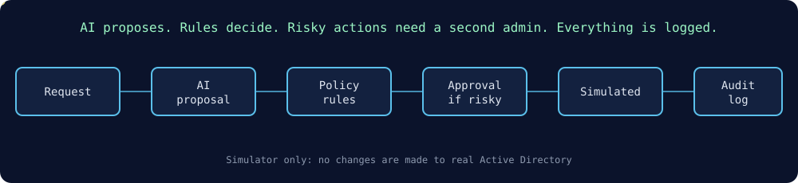
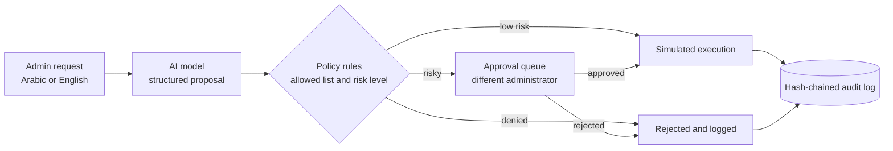
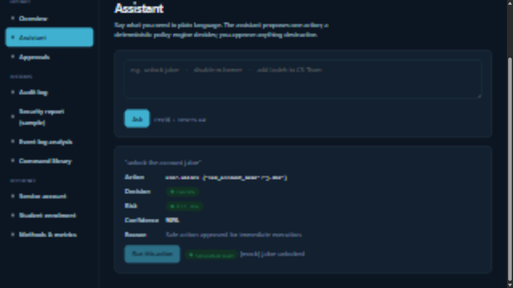
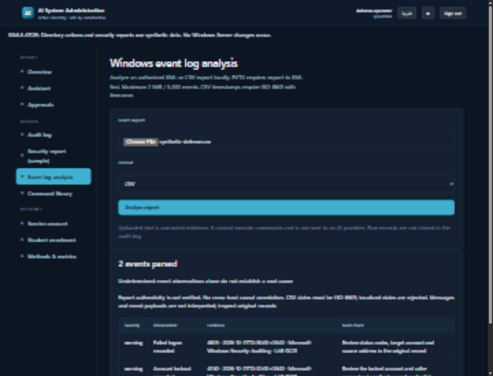

  
  
  
  
  

# AI System Administration Assistant

Graduation project, BEng Network Engineering and Security of Systems.

An assistant for Windows Server administrators. You ask for a task in plain language (Arabic or English). An AI model proposes a structured action, **fixed policy rules decide whether it is allowed**, and anything risky waits for a **second administrator to approve**. Every action and result is written to a tamper-evident audit log.

> **Status:** the project runs as a **simulator**. Changes to real Active Directory and Group Policy are disabled until the design is validated in an isolated Windows Server lab. Source code is private; this repository holds the design, screenshots and notes. Licence: all rights reserved (see LICENSE).

## The idea in one picture

## How it works

1. **Intent:** the model turns a request ("unlock the account jdoe") into a structured proposal. It never runs commands itself.
2. **Policy:** deterministic rules check the action and its parameters against an allowed list, with a risk level for each command.
3. **Approval:** sensitive actions go into a persistent queue and must be approved by a *different* administrator.
4. **Audit:** each attempt and result is added to a hash-chained log, so edits to history are detectable.
5. **Evidence tools:** Windows event-log exports (XML/CSV) are analysed locally. The content is never executed or sent to an AI service.

## What is built

- Python backend (FastAPI, Pydantic, SQLAlchemy), bcrypt and JWT login, role-based access
- SQLite for the local path and PostgreSQL in Docker for the online version
- Arabic and English web dashboard (assistant, approvals, audit log search and export, event-log analysis, command library, methods and metrics)
- Offline Group Policy workflow with synthetic read-back, protected backup manifests and recovery approvals
- 40+ automated test files covering policy, auth, audit chain, GPO workflow and evaluation
- Docker Compose deployment and PowerShell lab scripts

## Screenshots (synthetic data, simulation only)

## Design choices worth knowing

- **The model never executes anything.** It only produces a structured proposal; deterministic code decides what happens next.
- **Separation of duties.** The administrator who requests a risky action cannot approve it.
- **Tamper-evident history.** Each audit entry includes the hash of the one before it, so editing an old entry breaks the chain.
- **Evidence stays local.** Event-log files are parsed, never run, and never sent to an AI service.

## Not done yet (stated honestly)

- Real writes to Active Directory and Group Policy (blocked pending lab validation)
- Live directory collection, voice input, and a verified real-model evaluation

## Author

Ayham Bawaneh, BEng Network Engineering and Security of Systems, Al-Balqa Applied University (expected March 2027).
[LinkedIn](https://www.linkedin.com/in/ayham-bawaneh-865a71261/) | [nixas.link](https://nixas.link)
